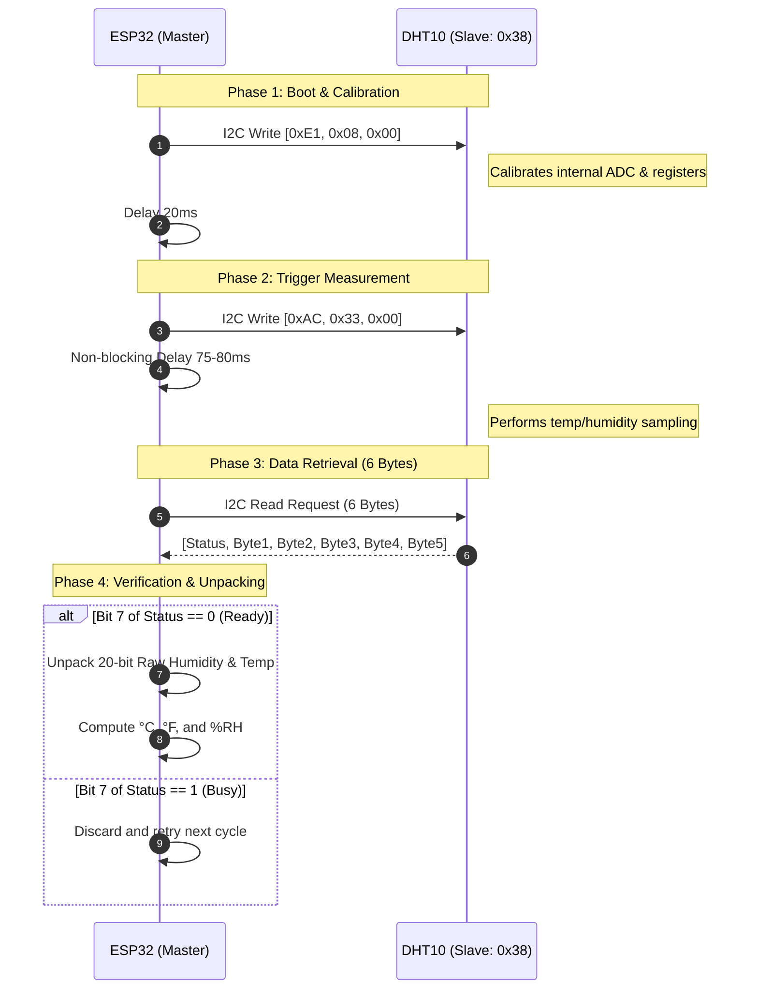

# DHT10 (AHT10) & ESP32 Code Summary & Technical Architecture

This document provides a comprehensive technical breakdown of how the **DHT10 (AHT10)** sensor interfaces with an **ESP32** across **Arduino (C++)**, **MicroPython**, and **ESP-IDF (C)**.

---

## 1. Hardware Overview & Pinout

Unlike the DHT11 and DHT22—which rely on a proprietary single-wire pulse-timing protocol—the **DHT10** is an **I2C digital relative humidity and temperature sensor** (manufactured by ASAIR/Aosong, part of the AHT10 family).

```
         ESP32                     DHT10 (AHT10)
    +--------------+              +--------------+
    |         3.3V |------------->| VCC / VDD    |
    |          GND |------------->| GND          |
    |      GPIO 21 |<------------>| SDA          |
    |      GPIO 22 |------------->| SCL          |
    +--------------+              +--------------+
```

| Pin | Default ESP32 Pin | Function | Notes |
| :--- | :--- | :--- | :--- |
| **VCC** | **3.3V** | Power Supply | 2.5V – 5.5V operating range (3.3V matches ESP32 logic) |
| **GND** | **GND** | Ground | Common reference ground |
| **SCL** | **GPIO 22** | I2C Clock Line | Hardware I2C Clock (100 kHz standard mode) |
| **SDA** | **GPIO 21** | I2C Data Line | Hardware I2C Bidirectional Data |

---

## 2. Sensor Communication Lifecycle

The DHT10 relies on a rigid command-response protocol over the 7-bit I2C address **`0x38`**.



---

## 3. Data Extraction & Mathematical Formulas

The sensor returns **6 raw bytes**:

```
[ Byte 0 ] : Status Register (Bit 7: Busy flag, Bit 3: Calibration status)
[ Byte 1 ] : Humidity [19:12]
[ Byte 2 ] : Humidity [11:4]
[ Byte 3 ] : Humidity [3:0] (High Nibble) | Temperature [19:16] (Low Nibble)
[ Byte 4 ] : Temperature [15:8]
[ Byte 5 ] : Temperature [7:0]
```

### A. Bitwise Assembly (20-bit integers)

- **Raw Humidity (20 bits):**
  $$\text{Raw}_{\text{hum}} = (\text{Byte}_1 \ll 12) \mid (\text{Byte}_2 \ll 4) \mid (\text{Byte}_3 \gg 4)$$

- **Raw Temperature (20 bits):**
  $$\text{Raw}_{\text{temp}} = ((\text{Byte}_3 \ \&\ \text{0x0F}) \ll 16) \mid (\text{Byte}_4 \ll 8) \mid \text{Byte}_5$$

### B. Engineering Conversions

Using the total scale of $2^{20} = 1,048,576$:

- **Relative Humidity (%):**
  $$\text{Humidity (\%)} = \left(\frac{\text{Raw}_{\text{hum}}}{1048576}\right) \times 100$$

- **Temperature (°C):**
  $$\text{Temperature (°C)} = \left(\frac{\text{Raw}_{\text{temp}}}{1048576}\right) \times 200 - 50$$

- **Temperature (°F):**
  $$\text{Temperature (°F)} = \left(\text{Temp}_{°C} \times \frac{9}{5}\right) + 32$$

---

## 4. Implementation Comparison Matrix

| Feature | Arduino Standalone (`DHT10_ESP32.ino`) | MicroPython (`main.py`) | ESP-IDF (`dht10_idf.c` / `esp_idf/`) | Arduino Adafruit (`DHT10_Adafruit.ino`) |
| :--- | :--- | :--- | :--- | :--- |
| **Language** | C++ | Python 3 (MicroPython) | C (C99/C11) | C++ |
| **Driver Layer** | Built-in `Wire.h` | `machine.I2C` & `machine.Pin` | Native `driver/i2c.h` | `Adafruit_AHTX0` / `Adafruit_BusIO` |
| **External Dependencies** | **None** | **None** | **None** | Requires 2 external libraries |
| **Concurrency / RTOS** | Arduino `delay()` | `time.sleep_ms()` | FreeRTOS (`vTaskDelay`) | Arduino `delay()` |
| **Memory Footprint** | Low (~250 KB flash) | Medium (~1.5 MB firmware) | Minimal (~180 KB flash) | Medium (~320 KB flash) |
| **Ideal For** | Quick prototyping & Arduino IDE users | Rapid experimentation, REPL, education | Commercial firmware, low-power & battery devices | Existing Adafruit Sensor ecosystem projects |

---

## 5. File Inventory & Breakdown

```
DHT10 Code/
├── CODE_SUMMARY.md       # Technical summary & reference (this document)
├── README.md             # Quick start and flashing manual
├── DHT10_ESP32.ino       # Zero-dependency Arduino sketch (Wire.h)
├── DHT10_Adafruit.ino    # Arduino sketch using the Adafruit AHTX0 library
├── main.py               # OOP MicroPython script with auto I2C bus scan
├── dht10_idf.c           # Standalone ESP-IDF C source file
└── esp_idf/              # Complete, buildable ESP-IDF CMake project
    ├── CMakeLists.txt    # Root project CMake configuration
    └── main/
        ├── CMakeLists.txt# Component registration
        └── main.c        # Application entrypoint (app_main)
```

---

## 6. Key Functions by Platform

### 1. Arduino Standalone ([`DHT10_ESP32.ino`](file:///Users/thenationalflagcompany/Documents/Projects/DHT10%20Code/DHT10_ESP32.ino))
- `Wire.begin(21, 22)`: Configures hardware I2C peripheral on pins 21 and 22.
- `initDHT10()`: Sends `0xE1 0x08 0x00` initialization sequence.
- `Wire.requestFrom(0x38, 6)`: Reads 6 raw data bytes and converts them using standard bitwise shifts.

### 2. MicroPython ([`main.py`](file:///Users/thenationalflagcompany/Documents/Projects/DHT10%20Code/main.py))
- `class DHT10`: Modular object-oriented driver accepting any `I2C` instance.
- `i2c.scan()`: Scans the bus and reports all connected peripheral addresses.
- `sensor.read()`: Triggers conversion, verifies busy flag, and returns `(temp_c, humidity)`.

### 3. ESP-IDF ([`dht10_idf.c`](file:///Users/thenationalflagcompany/Documents/Projects/DHT10%20Code/dht10_idf.c))
- `i2c_master_init()`: Configures `i2c_config_t` with internal pull-ups enabled (`GPIO_PULLUP_ENABLE`) and installs the driver via `i2c_driver_install()`.
- `dht10_read()`: Utilizes `i2c_master_write_to_device()` and `i2c_master_read_from_device()` with FreeRTOS tick timeouts (`pdMS_TO_TICKS`).
- `ESP_LOGI()`: Standard Espressif structured logging with log levels and tags.

---

## 7. Common Troubleshooting Tips

1. **Sensor Not Detected (`0x38` missing from scan):**
   - Check that `SDA` is connected to `GPIO 21` and `SCL` to `GPIO 22`.
   - Ensure the sensor has a solid 3.3V connection. If using long wires (> 20 cm), add 4.7kΩ pull-up resistors to SDA and SCL lines.
2. **Readings Stuck / "Sensor is Busy":**
   - The DHT10 requires at least **75–80ms** conversion time after the `0xAC 0x33 0x00` trigger command before reading back data. Reading too early returns `status & 0x80 == 1`.
3. **Sampling Frequency:**
   - Do not poll the sensor faster than once every 1–2 seconds to prevent internal self-heating and inaccurate temperature readings.
